# Simple Tensor Core

**Sepehr Hesampour**

**Target Equation:** `E = A × B + D` (4×4 matrices, 2-bit / 4-bit / 8-bit precision)

---

## Table of Contents

1. [Project Summary]
2. [Methodology & Workflow]
3. [Testing & Verification]
4. [Conclusion & Future Scope]
5. [Appendix A: Full Module Reference]

---

## 1. Project Summary

### 1.1 The Core Concept

This project is a hardware-level Machine Learning accelerator (a **tensor core**) written in Verilog. Its job is to compute the operation that dominates neural-network inference and training:

$$E = (A \times B) + D$$

where `A`, `B`, `D`, `E` are all **4×4 matrices**.
### 1.2 Technical Scope: One Physical Datapath, Three Logical Precisions

The 4×4 systolic grid is physically wired for **4-bit × 4-bit** multiply-accumulate. Rather than building three separate multiplier arrays, `simple_tensor_core` reuses the single 4-bit-wide grid for 2-bit, 4-bit, _and_ 8-bit operands:

- **2-bit / 4-bit modes** run the grid **once** (a single pass), with the operands masked down to fit the 4-bit lanes.
- **8-bit mode** decomposes each 8-bit operand into a high nibble and a low nibble and runs the grid **four times** (`LL`, `LH`, `HL`, `HH` partial products), then recombines the four 12-bit partial results into a 20-bit final element in `io_manager`.

### 1.3 Signed Operands

Every precision mode supports **negative** inputs and outputs, not just unsigned magnitudes. `A`, `B`, and `D` are always interpreted as two's-complement numbers. Section 2.6 walks through exactly how a normally-unsigned AND/shift/add multiplier is turned into a correct two's-complement one with only two extra control bits.

---

## 2. Methodology & Workflow

The design was built exactly following the four phases of the assignment. Each phase's modules were verified in isolation.

### 2.0 Full Module Hierarchy

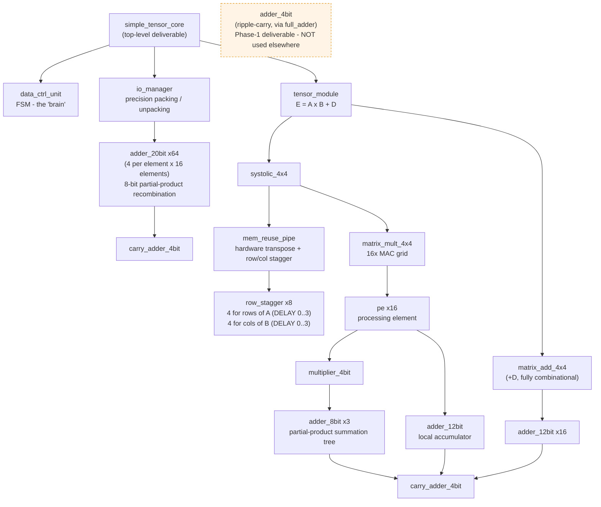

### 2.1 Phase 1 — Primitive Logic & Arithmetic

| Module             | Built From                                                                            | Purpose                                              |
| ------------------ | ------------------------------------------------------------------------------------- | ---------------------------------------------------- |
| `full_adder`       | Gates (`^`, `&`, `\|`)                                                                | 1-bit sum/carry primitive                            |
| `adder_4bit`       | 4× `full_adder`, chained                                                              | Ripple-carry 4-bit adder                             |
| `carry_adder_4bit` | Generate/Propagate logic                                                              | Carry-**lookahead** 4-bit adder                      |
| `multiplier_4bit`  | AND-gate partial products + `adder_8bit` chain, with `A_signed`/`B_signed` correction | 4-bit × 4-bit → 8-bit multiplier, signed or unsigned |

**`full_adder` and `adder_4bit`:**

```verilog
module full_adder(
    input  A, B, Cin,
    output S, Cout
);
    assign S    = A ^ B ^ Cin;
    assign Cout = (A & B) | (Cin & (A ^ B));
endmodule

module adder_4bit(
    input  [3:0] A, B,
    input        Cin,
    output [3:0] Sum,
    output       Cout
);
    wire c1, c2, c3;

    full_adder fa0 (.A(A[0]), .B(B[0]), .Cin(Cin), .S(Sum[0]), .Cout(c1));
    full_adder fa1 (.A(A[1]), .B(B[1]), .Cin(c1),  .S(Sum[1]), .Cout(c2));
    full_adder fa2 (.A(A[2]), .B(B[2]), .Cin(c2),  .S(Sum[2]), .Cout(c3));
    full_adder fa3 (.A(A[3]), .B(B[3]), .Cin(c3),  .S(Sum[3]), .Cout(Cout));
endmodule
```

**`carry_adder_4bit` the faster replacement used:**

```verilog
module carry_adder_4bit(
    input  [3:0] A, B,
    input        Cin,
    output [3:0] Sum,
    output       Cout
);
    wire [3:0] G, P;
    wire C0, C1, C2, C3, C4;

    assign G = A & B;
    assign P = A ^ B;
    assign C0 = Cin;

    assign C1 = G[0] | (P[0] & C0);
    assign C2 = G[1] | (P[1] & G[0]) | (P[1] & P[0] & C0);
    assign C3 = G[2] | (P[2] & G[1]) | (P[2] & P[1] & G[0]) | (P[2] & P[1] & P[0] & C0);
    assign C4 = G[3] | (P[3] & G[2]) | (P[3] & P[2] & G[1]) | (P[3] & P[2] & P[1] & G[0])
                      | (P[3] & P[2] & P[1] & P[0] & C0);

    assign Sum[0] = P[0] ^ C0;
    assign Sum[1] = P[1] ^ C1;
    assign Sum[2] = P[2] ^ C2;
    assign Sum[3] = P[3] ^ C3;
    assign Cout   = C4;
endmodule
```

Every carry ($C_1$ through $C_4$) is computed **directly** from the generate/propagate ($G$, $P$) signals of _all_ preceding bits in one shot. This is what makes it faster than the ripple-carry version(see the waveform comparison in 3.4, Figures 1-2.)

**Widening adders built for internal reuse** (required engineering additions once matrices and 8-bit precision entered the picture). All three follow the identical pattern of chaining `carry_adder_4bit` nibbles with the carry rippling only _between_ 4-bit blocks:

```verilog
module adder_8bit(
    input  [7:0] A, B,
    input        Cin,
    output [7:0] Sum,
    output       Cout
);
    wire c_mid;

    carry_adder_4bit low_nibble  (.A(A[3:0]), .B(B[3:0]), .Cin(Cin),   .Sum(Sum[3:0]), .Cout(c_mid));
    carry_adder_4bit high_nibble (.A(A[7:4]), .B(B[7:4]), .Cin(c_mid), .Sum(Sum[7:4]), .Cout(Cout));
endmodule

module adder_12bit(
    input  [11:0] A, B,
    input         Cin,
    output [11:0] Sum,
    output        Cout
);
    wire c1, c2;

    carry_adder_4bit low  (.A(A[3:0]),  .B(B[3:0]),  .Cin(Cin), .Sum(Sum[3:0]),  .Cout(c1));
    carry_adder_4bit mid  (.A(A[7:4]),  .B(B[7:4]),  .Cin(c1),  .Sum(Sum[7:4]),  .Cout(c2));
    carry_adder_4bit high (.A(A[11:8]), .B(B[11:8]), .Cin(c2),  .Sum(Sum[11:8]), .Cout(Cout));
endmodule
```

_(`adder_20bit`, the 5-nibble version of this same pattern, is used exclusively by `io_manager`.)_

**`multiplier_4bit`:**

```verilog
module multiplier_4bit(
    input  [3:0] A, B,
    input        A_signed, B_signed,
    output [7:0] Product
);
    wire [3:0] pp0 = A & {4{B[0]}};
    wire [3:0] pp1 = A & {4{B[1]}};
    wire [3:0] pp2 = A & {4{B[2]}};
    wire [3:0] pp3 = A & {4{B[3]}};

    wire ext0 = A_signed & pp0[3];
    wire ext1 = A_signed & pp1[3];
    wire ext2 = A_signed & pp2[3];
    wire ext3 = A_signed & pp3[3];

    wire [7:0] pp0_ext = {{4{ext0}}, pp0};
    wire [7:0] pp1_ext = {{3{ext1}}, pp1, 1'b0};
    wire [7:0] pp2_ext = {{2{ext2}}, pp2, 2'b00};
    wire [7:0] pp3_ext = {{1{ext3}}, pp3, 3'b000};

    wire [7:0] pp3_final = B_signed ? ~pp3_ext : pp3_ext;

    wire [7:0] sum1, sum2;
    adder_8bit add_stage1 (.A(pp0_ext), .B(pp1_ext), .Cin(1'b0), .Sum(sum1),    .Cout());
    adder_8bit add_stage2 (.A(sum1),    .B(pp2_ext), .Cin(1'b0), .Sum(sum2),    .Cout());
    adder_8bit add_stage3 (.A(sum2),    .B(pp3_final), .Cin(B_signed), .Sum(Product), .Cout());
endmodule
```

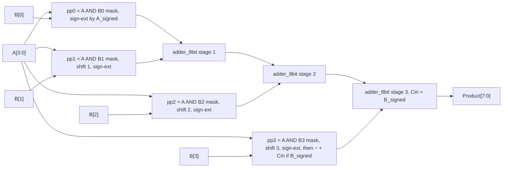

**2.1.1 Turning an unsigned AND/shift/add multiplier into a signed one.**

A plain AND-based partial-product multiplier is inherently unsigned: `pp_i = A & {4{B[i]}}` just picks "A or 0" for each bit position, and every partial product contributes `+A × 2^i`. That's correct for every bit of `B` *except* the top one, in two's complement, `B[3]` doesn't mean "+8", it means **"−8"**. Left uncorrected, this multiplier would compute the wrong sign whenever the sign bit of a signed operand is set.

Two independent corrections are needed, gated by two control bits:

- **`A_signed`**: if `A` is signed, each partial product must be **sign-extended**, not zero-extended, before summation (`ext_i = A_signed & pp_i[3]`, replicated into the upper bits of `pp_i_ext`). If `A_signed` is 0 (unsigned mode), `ext_i` is forced to 0 and this degrades exactly to the plain zero-extended case.
- **`B_signed`**: if `B` is signed, the *last* partial product (`pp3`, weighted by `B[3]`) represents a **negative** contribution and must be subtracted, not added. Building a subtractor would mean duplicating the adder chain, so instead this design uses the two's-complement identity `−X = ~X + 1`: `pp3` is bitwise-inverted (`pp3_final = B_signed ? ~pp3_ext : pp3_ext`) and `B_signed` itself is fed in as the `Cin` of the final `adder_8bit` stage, supplying the "`+1`". When `B_signed` is 0, `pp3_final = pp3_ext` and `Cin = 0`, so unsigned multiplication is unaffected.

### 2.2 Phase 2: The Compute Core

**Processing Element (`pe`):**

```verilog
module pe(
    input  clk, reset,
    input  [3:0]  a_in, b_in,
    input         a_signed, b_signed,
    input  [11:0] sum_in,
    output reg [3:0]  a_out, b_out,
    output reg [11:0] sum_out
);
    wire [7:0]  product;
    multiplier_4bit mult (
        .A(a_in), .B(b_in),
        .A_signed(a_signed), .B_signed(b_signed),
        .Product(product)
    );

    wire p_signed = a_signed | b_signed;
    wire p_ext_bit = p_signed & product[7];
    wire [11:0] product_ext = {{4{p_ext_bit}}, product};

    wire [11:0] sum_next;
    adder_12bit acc_add (.A(sum_in), .B(product_ext), .Cin(1'b0), .Sum(sum_next), .Cout());

    always @(posedge clk) begin
        if (reset) begin
            a_out   <= 4'b0;
            b_out   <= 4'b0;
            sum_out <= 12'b0;
        end else begin
            a_out   <= a_in;
            b_out   <= b_in;
            sum_out <= sum_next;
        end
    end
endmodule
```

| Port                   | Dir       | Width | Meaning                                                                                          |
| ---------------------- | --------- | ----- | ------------------------------------------------------------------------------------------------ |
| `clk`, `reset`         | in        | 1     | Synchronous, active-high reset                                                                   |
| `a_in`, `b_in`         | in        | 4     | Streaming operand nibbles from the west / north neighbor                                         |
| `a_signed`, `b_signed` | in        | 1     | Broadcast from the top level; tells `multiplier_4bit` whether `a_in`/`b_in` are two's-complement |
| `sum_in`               | in        | 12    | Fed back from this cell's **own** `sum_out`                                                      |
| `a_out`, `b_out`       | out (reg) | 4     | Registered pass-through to east / south neighbor                                                 |
| `sum_out`              | out (reg) | 12    | Registered running accumulator = $C_{ij}$                                                        |

Note the product's sign-extension into the 12-bit accumulator (`p_ext_bit = p_signed & product[7]`): if *either* operand was signed, the 8-bit product is a signed quantity and its sign bit must be replicated up to 12 bits before accumulating. If neither operand was signed, `p_signed` is 0 and this degrades to a plain zero-extend, exactly as in the unsigned case.

**Instantiating the 4×4 grid (`matrix_mult_4x4`).**
Every cell follows the identical wiring rule: _`a_in` comes from the west neighbor's `a_out` (or the edge input on column 0); `b_in` comes from the north neighbor's `b_out` (or the edge input on row 0); `sum_in` is tied back to the cell's own output._

```verilog
module matrix_mult_4x4(
    input  clk, reset,
    input  a_signed, b_signed,
    input  [3:0] a_edge0, a_edge1, a_edge2, a_edge3,
    input  [3:0] b_edge0, b_edge1, b_edge2, b_edge3,
    output [11:0] c00, c01, c02, c03,
    output [11:0] c10, c11, c12, c13,
    output [11:0] c20, c21, c22, c23,
    output [11:0] c30, c31, c32, c33
);
    wire [3:0] a_pass_0_0, a_pass_0_1, a_pass_0_2, a_pass_0_3;
    wire [3:0] a_pass_1_0, a_pass_1_1, a_pass_1_2, a_pass_1_3;
    wire [3:0] a_pass_2_0, a_pass_2_1, a_pass_2_2, a_pass_2_3;
    wire [3:0] a_pass_3_0, a_pass_3_1, a_pass_3_2, a_pass_3_3;

    wire [3:0] b_pass_0_0, b_pass_0_1, b_pass_0_2, b_pass_0_3;
    wire [3:0] b_pass_1_0, b_pass_1_1, b_pass_1_2, b_pass_1_3;
    wire [3:0] b_pass_2_0, b_pass_2_1, b_pass_2_2, b_pass_2_3;

    pe pe00 (.clk(clk), .reset(reset), .a_in(a_edge0),    .b_in(b_edge0),    .a_signed(a_signed), .b_signed(b_signed), .sum_in(c00), .a_out(a_pass_0_0), .b_out(b_pass_0_0), .sum_out(c00));
    pe pe01 (.clk(clk), .reset(reset), .a_in(a_pass_0_0), .b_in(b_edge1),    .a_signed(a_signed), .b_signed(b_signed), .sum_in(c01), .a_out(a_pass_0_1), .b_out(b_pass_0_1), .sum_out(c01));
    pe pe02 (.clk(clk), .reset(reset), .a_in(a_pass_0_1), .b_in(b_edge2),    .a_signed(a_signed), .b_signed(b_signed), .sum_in(c02), .a_out(a_pass_0_2), .b_out(b_pass_0_2), .sum_out(c02));
    pe pe03 (.clk(clk), .reset(reset), .a_in(a_pass_0_2), .b_in(b_edge3),    .a_signed(a_signed), .b_signed(b_signed), .sum_in(c03), .a_out(a_pass_0_3), .b_out(b_pass_0_3), .sum_out(c03));

    pe pe10 (.clk(clk), .reset(reset), .a_in(a_edge1),    .b_in(b_pass_0_0), .a_signed(a_signed), .b_signed(b_signed), .sum_in(c10), .a_out(a_pass_1_0), .b_out(b_pass_1_0), .sum_out(c10));
    pe pe11 (.clk(clk), .reset(reset), .a_in(a_pass_1_0), .b_in(b_pass_0_1), .a_signed(a_signed), .b_signed(b_signed), .sum_in(c11), .a_out(a_pass_1_1), .b_out(b_pass_1_1), .sum_out(c11));
    pe pe12 (.clk(clk), .reset(reset), .a_in(a_pass_1_1), .b_in(b_pass_0_2), .a_signed(a_signed), .b_signed(b_signed), .sum_in(c12), .a_out(a_pass_1_2), .b_out(b_pass_1_2), .sum_out(c12));
    pe pe13 (.clk(clk), .reset(reset), .a_in(a_pass_1_2), .b_in(b_pass_0_3), .a_signed(a_signed), .b_signed(b_signed), .sum_in(c13), .a_out(a_pass_1_3), .b_out(b_pass_1_3), .sum_out(c13));

    pe pe20 (.clk(clk), .reset(reset), .a_in(a_edge2),    .b_in(b_pass_1_0), .a_signed(a_signed), .b_signed(b_signed), .sum_in(c20), .a_out(a_pass_2_0), .b_out(b_pass_2_0), .sum_out(c20));
    pe pe21 (.clk(clk), .reset(reset), .a_in(a_pass_2_0), .b_in(b_pass_1_1), .a_signed(a_signed), .b_signed(b_signed), .sum_in(c21), .a_out(a_pass_2_1), .b_out(b_pass_2_1), .sum_out(c21));
    pe pe22 (.clk(clk), .reset(reset), .a_in(a_pass_2_1), .b_in(b_pass_1_2), .a_signed(a_signed), .b_signed(b_signed), .sum_in(c22), .a_out(a_pass_2_2), .b_out(b_pass_2_2), .sum_out(c22));
    pe pe23 (.clk(clk), .reset(reset), .a_in(a_pass_2_2), .b_in(b_pass_1_3), .a_signed(a_signed), .b_signed(b_signed), .sum_in(c23), .a_out(a_pass_2_3), .b_out(b_pass_2_3), .sum_out(c23));

    pe pe30 (.clk(clk), .reset(reset), .a_in(a_edge3),    .b_in(b_pass_2_0), .a_signed(a_signed), .b_signed(b_signed), .sum_in(c30), .a_out(a_pass_3_0), .b_out(), .sum_out(c30));
    pe pe31 (.clk(clk), .reset(reset), .a_in(a_pass_3_0), .b_in(b_pass_2_1), .a_signed(a_signed), .b_signed(b_signed), .sum_in(c31), .a_out(a_pass_3_1), .b_out(), .sum_out(c31));
    pe pe32 (.clk(clk), .reset(reset), .a_in(a_pass_3_1), .b_in(b_pass_2_2), .a_signed(a_signed), .b_signed(b_signed), .sum_in(c32), .a_out(a_pass_3_2), .b_out(), .sum_out(c32));
    pe pe33 (.clk(clk), .reset(reset), .a_in(a_pass_3_2), .b_in(b_pass_2_3), .a_signed(a_signed), .b_signed(b_signed), .sum_in(c33), .a_out(),           .b_out(), .sum_out(c33));
endmodule
```

`a_signed`/`b_signed` are a single pair of wires broadcast to all 16 `pe` cells — every cell in a given operation is either "all signed" or "all unsigned" together (which value it actually is depends on precision mode and, in 8-bit mode, which nibble-pass is running; see 2.6).

**4×4 grid dataflow:**

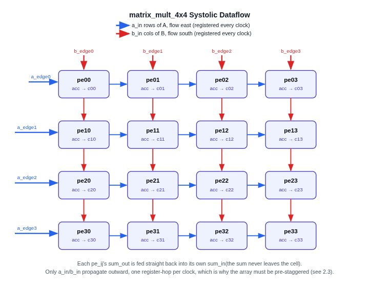

### 2.3 Phase 2: Hardware Data Formatting

Two problems have to be solved before the grid above can be fed correctly:

**Problem 1: Timing/staggering.** Row 0 of `A` must reach `pe00` at cycle 0, but row 1 must _not_ arrive at `pe10` until cycle 1 (it needs to line up with the `b` value that has, by then, propagated one row down from `pe00`). `row_stagger #(.DELAY(n))` solves this with a small shift-register delay chain: a `start` pulse is delayed by `n` cycles before it triggers a parallel-load of that row/column into a 16-bit shift register, which then shifts out one nibble (`a_out`) per clock.

```verilog
module row_stagger #(parameter DELAY = 0) (
    input  clk, reset, start,
    input  [15:0] row_data,
    output [3:0]  a_out
);
    wire load_pulse;

    generate
        if (DELAY == 0) begin : no_delay
            assign load_pulse = start;
        end else begin : delay_chain
            reg [DELAY-1:0] chain;
            integer k;
            always @(posedge clk) begin
                if (reset)
                    chain <= {DELAY{1'b0}};
                else begin
                    chain[0] <= start;
                    for (k = 1; k < DELAY; k = k + 1)
                        chain[k] <= chain[k-1];
                end
            end
            assign load_pulse = chain[DELAY-1];
        end
    endgenerate

    reg [15:0] shift_reg;

    always @(posedge clk) begin
        if (reset)
            shift_reg <= 16'b0;
        else if (load_pulse)
            shift_reg <= row_data;
        else
            shift_reg <= {4'b0000, shift_reg[15:4]};
    end

    assign a_out = shift_reg[3:0];
endmodule
```

**Problem 2: Orientation.** `B_flat` is stored **row-major** (`B_flat[63:0]` = row0‖row1‖row2‖row3, 16 bits each), but the systolic array needs **columns** of `B` streamed in from the top. Rather than spending clock cycles transposing the matrix, `mem_reuse_pipe` **rewires the bits**:

```verilog
module mem_reuse_pipe(
    input  clk, reset, start,
    input  [63:0] A_flat,
    input  [63:0] B_flat,
    output [3:0]  a_edge0, a_edge1, a_edge2, a_edge3,
    output [3:0]  b_edge0, b_edge1, b_edge2, b_edge3
);
    wire [15:0] a_row0 = A_flat[15:0];
    wire [15:0] a_row1 = A_flat[31:16];
    wire [15:0] a_row2 = A_flat[47:32];
    wire [15:0] a_row3 = A_flat[63:48];

    wire [15:0] b_col0 = {B_flat[51:48], B_flat[35:32], B_flat[19:16], B_flat[3:0]};
    wire [15:0] b_col1 = {B_flat[55:52], B_flat[39:36], B_flat[23:20], B_flat[7:4]};
    wire [15:0] b_col2 = {B_flat[59:56], B_flat[43:40], B_flat[27:24], B_flat[11:8]};
    wire [15:0] b_col3 = {B_flat[63:60], B_flat[47:44], B_flat[31:28], B_flat[15:12]};

    row_stagger #(.DELAY(0)) rs_a0 (.clk(clk), .reset(reset), .start(start), .row_data(a_row0), .a_out(a_edge0));
    row_stagger #(.DELAY(1)) rs_a1 (.clk(clk), .reset(reset), .start(start), .row_data(a_row1), .a_out(a_edge1));
    row_stagger #(.DELAY(2)) rs_a2 (.clk(clk), .reset(reset), .start(start), .row_data(a_row2), .a_out(a_edge2));
    row_stagger #(.DELAY(3)) rs_a3 (.clk(clk), .reset(reset), .start(start), .row_data(a_row3), .a_out(a_edge3));

    row_stagger #(.DELAY(0)) rs_b0 (.clk(clk), .reset(reset), .start(start), .row_data(b_col0), .a_out(b_edge0));
    row_stagger #(.DELAY(1)) rs_b1 (.clk(clk), .reset(reset), .start(start), .row_data(b_col1), .a_out(b_edge1));
    row_stagger #(.DELAY(2)) rs_b2 (.clk(clk), .reset(reset), .start(start), .row_data(b_col2), .a_out(b_edge2));
    row_stagger #(.DELAY(3)) rs_b3 (.clk(clk), .reset(reset), .start(start), .row_data(b_col3), .a_out(b_edge3));
endmodule
```

Each `b_colN` wire picks out element `[row][N]` from every row and concatenates them.

**Assembling the array (`systolic_4x4`):**

```verilog
module systolic_4x4(
    input  clk, reset, start,
    input  a_signed, b_signed,
    input  [63:0] A_flat,
    input  [63:0] B_flat,
    output [11:0] c00, c01, c02, c03,
    output [11:0] c10, c11, c12, c13,
    output [11:0] c20, c21, c22, c23,
    output [11:0] c30, c31, c32, c33
);
    wire [3:0] a_edge0, a_edge1, a_edge2, a_edge3;
    wire [3:0] b_edge0, b_edge1, b_edge2, b_edge3;

    mem_reuse_pipe mrp (
        .clk(clk), .reset(reset), .start(start),
        .A_flat(A_flat), .B_flat(B_flat),
        .a_edge0(a_edge0), .a_edge1(a_edge1), .a_edge2(a_edge2), .a_edge3(a_edge3),
        .b_edge0(b_edge0), .b_edge1(b_edge1), .b_edge2(b_edge2), .b_edge3(b_edge3)
    );

    matrix_mult_4x4 mm (
        .clk(clk), .reset(reset),
        .a_signed(a_signed), .b_signed(b_signed),
        .a_edge0(a_edge0), .a_edge1(a_edge1), .a_edge2(a_edge2), .a_edge3(a_edge3),
        .b_edge0(b_edge0), .b_edge1(b_edge1), .b_edge2(b_edge2), .b_edge3(b_edge3),
        .c00(c00), .c01(c01), .c02(c02), .c03(c03),
        .c10(c10), .c11(c11), .c12(c12), .c13(c13),
        .c20(c20), .c21(c21), .c22(c22), .c23(c23),
        .c30(c30), .c31(c31), .c32(c32), .c33(c33)
    );
endmodule
```

`systolic_4x4` itself makes no sign decisions, it just forwards `a_signed`/`b_signed` from its caller down into the grid. That decision is made one level up, in `tensor_module` (2.6), based on precision mode and (for 8-bit mode) which nibble-pass is currently running.

### 2.4 Phase 3: The Tensor Module

`matrix_add_4x4` is 16 parallel `adder_12bit` instances, one per output element.

```verilog
module matrix_add_4x4(
    input  [11:0] c00,c01,c02,c03,
    input  [11:0] c10,c11,c12,c13,
    input  [11:0] c20,c21,c22,c23,
    input  [11:0] c30,c31,c32,c33,
    input  [63:0] D_flat,
    output [11:0] e00,e01,e02,e03,
    output [11:0] e10,e11,e12,e13,
    output [11:0] e20,e21,e22,e23,
    output [11:0] e30,e31,e32,e33
);
    wire [11:0] d00 = {8'b0, D_flat[3:0]};
    wire [11:0] d01 = {8'b0, D_flat[7:4]};
    wire [11:0] d02 = {8'b0, D_flat[11:8]};
    wire [11:0] d03 = {8'b0, D_flat[15:12]};
    wire [11:0] d10 = {8'b0, D_flat[19:16]};
    wire [11:0] d11 = {8'b0, D_flat[23:20]};
    wire [11:0] d12 = {8'b0, D_flat[27:24]};
    wire [11:0] d13 = {8'b0, D_flat[31:28]};
    wire [11:0] d20 = {8'b0, D_flat[35:32]};
    wire [11:0] d21 = {8'b0, D_flat[39:36]};
    wire [11:0] d22 = {8'b0, D_flat[43:40]};
    wire [11:0] d23 = {8'b0, D_flat[47:44]};
    wire [11:0] d30 = {8'b0, D_flat[51:48]};
    wire [11:0] d31 = {8'b0, D_flat[55:52]};
    wire [11:0] d32 = {8'b0, D_flat[59:56]};
    wire [11:0] d33 = {8'b0, D_flat[63:60]};

    adder_12bit a00(.A(c00), .B(d00), .Cin(1'b0), .Sum(e00), .Cout());
    adder_12bit a01(.A(c01), .B(d01), .Cin(1'b0), .Sum(e01), .Cout());
    adder_12bit a02(.A(c02), .B(d02), .Cin(1'b0), .Sum(e02), .Cout());
    adder_12bit a03(.A(c03), .B(d03), .Cin(1'b0), .Sum(e03), .Cout());
    /* a10..a33 repeat the identical (c, d) -> e pattern, 12 more instances */
endmodule
```

`tensor_module` routes `systolic_4x4`'s output (`C = A×B`) into one side of `matrix_add_4x4`, and `D_flat` into the other:

```verilog
module tensor_module(
    input  clk, reset, start,
    input  [63:0] A_flat, B_flat, D_flat,
    output [191:0] E_flat
);
    wire [11:0] c00,c01,c02,c03, c10,c11,c12,c13, c20,c21,c22,c23, c30,c31,c32,c33;
    wire [11:0] e00,e01,e02,e03, e10,e11,e12,e13, e20,e21,e22,e23, e30,e31,e32,e33;

    systolic_4x4 sys (
        .clk(clk), .reset(reset), .start(start),
        .A_flat(A_flat), .B_flat(B_flat),
        .c00(c00), .c01(c01), .c02(c02), .c03(c03),
        .c10(c10), .c11(c11), .c12(c12), .c13(c13),
        .c20(c20), .c21(c21), .c22(c22), .c23(c23),
        .c30(c30), .c31(c31), .c32(c32), .c33(c33)
    );

    matrix_add_4x4 madd (
        .c00(c00), .c01(c01), .c02(c02), .c03(c03),
        .c10(c10), .c11(c11), .c12(c12), .c13(c13),
        .c20(c20), .c21(c21), .c22(c22), .c23(c23),
        .c30(c30), .c31(c31), .c32(c32), .c33(c33),
        .D_flat(D_flat),
        .e00(e00), .e01(e01), .e02(e02), .e03(e03),
        .e10(e10), .e11(e11), .e12(e12), .e13(e13),
        .e20(e20), .e21(e21), .e22(e22), .e23(e23),
        .e30(e30), .e31(e31), .e32(e32), .e33(e33)
    );

    assign E_flat = {e33,e32,e31,e30, e23,e22,e21,e20, e13,e12,e11,e10, e03,e02,e01,e00};
endmodule
```

### 2.5 Final Phase: Control Unit and Multi-Precision

**`adder_20bit`:** the fifth and widest adder in the hierarchy, used exclusively by `io_manager` below:

```verilog
module adder_20bit(
    input  [19:0] A, B,
    input         Cin,
    output [19:0] Sum,
    output        Cout
);
    wire c1, c2, c3, c4;

    carry_adder_4bit n0 (.A(A[3:0]),   .B(B[3:0]),   .Cin(Cin), .Sum(Sum[3:0]),   .Cout(c1));
    carry_adder_4bit n1 (.A(A[7:4]),   .B(B[7:4]),   .Cin(c1),  .Sum(Sum[7:4]),   .Cout(c2));
    carry_adder_4bit n2 (.A(A[11:8]),  .B(B[11:8]),  .Cin(c2),  .Sum(Sum[11:8]),  .Cout(c3));
    carry_adder_4bit n3 (.A(A[15:12]), .B(B[15:12]), .Cin(c3),  .Sum(Sum[15:12]), .Cout(c4));
    carry_adder_4bit n4 (.A(A[19:16]), .B(B[19:16]), .Cin(c4),  .Sum(Sum[19:16]), .Cout(Cout));
endmodule
```

**`data_ctrl_unit`: the FSM "brain":**

```verilog
module data_ctrl_unit(
    input        clk, reset, start,
    input  [1:0] mode,
    output reg        core_reset,
    output reg        core_start,
    output reg [1:0]  pass_idx,
    output reg        capture_en,
    output reg        combine_en,
    output reg        valid,
    output reg        busy,
    output             idle
);
    localparam S_IDLE       = 3'd0,
               S_CORE_RESET = 3'd1,
               S_RUN        = 3'd2,
               S_CAPTURE    = 3'd3,
               S_COMBINE    = 3'd4,
               S_DONE       = 3'd5;

    reg [2:0] state;
    reg [3:0] run_ctr;
    reg [1:0] mode_r;

    wire is_8bit = (mode_r == 2'b10);
    assign idle = (state == S_IDLE);

    always @(posedge clk) begin
        if (reset) begin
            state      <= S_IDLE;
            core_reset <= 1'b0;
            core_start <= 1'b0;
            pass_idx   <= 2'd0;
            capture_en <= 1'b0;
            combine_en <= 1'b0;
            valid      <= 1'b0;
            busy       <= 1'b0;
            run_ctr    <= 4'd0;
            mode_r     <= 2'b00;
        end else begin
            core_reset <= 1'b0;
            core_start <= 1'b0;
            capture_en <= 1'b0;
            combine_en <= 1'b0;

            case (state)
                S_IDLE: begin
                    busy  <= 1'b0;
                    if (start) begin
                        valid    <= 1'b0;
                        mode_r   <= mode;
                        pass_idx <= 2'd0;
                        busy     <= 1'b1;
                        state    <= S_CORE_RESET;
                    end
                end

                S_CORE_RESET: begin
                    core_reset <= 1'b1;
                    run_ctr    <= 4'd0;
                    if (capture_en)
                        pass_idx <= pass_idx + 2'd1;
                    state <= S_RUN;
                end

                S_RUN: begin
                    if (run_ctr == 4'd0)
                        core_start <= 1'b1;
                    if (run_ctr == 4'd10)
                        state <= S_CAPTURE;
                    else
                        run_ctr <= run_ctr + 4'd1;
                end

                S_CAPTURE: begin
                    capture_en <= 1'b1;
                    if (is_8bit && pass_idx != 2'd3) begin
                        state <= S_CORE_RESET;
                    end else begin
                        state <= S_COMBINE;
                    end
                end

                S_COMBINE: begin
                    combine_en <= 1'b1;
                    state      <= S_DONE;
                end

                S_DONE: begin
                    valid <= 1'b1;
                    busy  <= 1'b0;
                    state <= S_IDLE;
                end

                default: state <= S_IDLE;
            endcase
        end
    end
endmodule
```

```mermaid
stateDiagram-v2
    [*] --> S_IDLE
    S_IDLE --> S_CORE_RESET: start == 1, latches mode, pass_idx=0, busy=1
    S_CORE_RESET --> S_RUN: pulses core_reset; if capture_en, pass_idx increments
    S_RUN --> S_RUN: run_ctr < 10, core_start pulses once at run_ctr==0
    S_RUN --> S_CAPTURE: run_ctr == 10
    S_CAPTURE --> S_CORE_RESET: is_8bit AND pass_idx != 3, loop for next nibble pass
    S_CAPTURE --> S_COMBINE: NOT is_8bit OR pass_idx == 3
    S_COMBINE --> S_DONE: combine_en pulses, io_manager recombines partials
    S_DONE --> S_IDLE: valid pulses high for 1 cycle, busy=0
```

| State              | `core_reset` | `core_start` | `capture_en` | `combine_en` | `busy`                          | `valid` |
| ------------------ | ------------ | ------------ | ------------ | ------------ | -------------------------------- | ------- |
| `S_IDLE`           | 0            | 0            | 0            | 0            | 0 (1 while waiting for `start`)  | 0       |
| `S_CORE_RESET`     | **1**        | 0            | 0            | 0            | 1                                 | 0       |
| `S_RUN` (cyc 0)    | 0            | **1**        | 0            | 0            | 1                                 | 0       |
| `S_RUN` (cyc 1–10) | 0            | 0            | 0            | 0            | 1                                 | 0       |
| `S_CAPTURE`        | 0            | 0            | **1**        | 0            | 1                                 | 0       |
| `S_COMBINE`        | 0            | 0            | 0            | **1**        | 1                                 | 0       |
| `S_DONE`           | 0            | 0            | 0            | 0            | 0                                 | **1**   |

For **2-bit and 4-bit modes**, the grid runs a single pass (`S_CAPTURE → S_COMBINE` directly). 
For **8-bit mode**, `S_CAPTURE` loops back to `S_CORE_RESET` three more times (`pass_idx` 0→1→2→3) before finally proceeding to `S_COMBINE`, this exact loop is visible on waveform in 3.4, Figure 10.

**`io_manager`: precision packing/unpacking:**

```verilog
module io_manager(
    input          clk, reset,
    input          latch_en,
    input  [1:0]   mode,
    input  [127:0] A_in, B_in, D_in,
    input  [1:0]   pass_idx,
    input          capture_en,
    input          combine_en,
    input  [191:0] core_E_flat,
    output [63:0]  core_A_flat,
    output [63:0]  core_B_flat,
    output [63:0]  core_D_flat,
    output [319:0] E_out
);
    reg [1:0]   mode_reg;
    reg [127:0] A_reg, B_reg, D_reg;

    always @(posedge clk) begin
        if (reset) begin
            mode_reg <= 2'b00;
            A_reg    <= 128'b0;
            B_reg    <= 128'b0;
            D_reg    <= 128'b0;
        end else if (latch_en) begin
            mode_reg <= mode;
            A_reg    <= A_in;
            B_reg    <= B_in;
            D_reg    <= D_in;
        end
    end

    function automatic [3:0] operand_nibble;
        input [7:0] slot;
        input [1:0] md;
        input       use_hi;
        begin
            case (md)
                2'b00:   operand_nibble = {2'b00, slot[1:0]};
                2'b01:   operand_nibble = slot[3:0];
                2'b10:   operand_nibble = use_hi ? slot[7:4] : slot[3:0];
                default: operand_nibble = slot[3:0];
            endcase
        end
    endfunction

    wire a_use_hi = (pass_idx == 2'd2) || (pass_idx == 2'd3);
    wire b_use_hi = (pass_idx == 2'd1) || (pass_idx == 2'd3);

    genvar k;
    generate
        for (k = 0; k < 16; k = k + 1) begin : mux_operands
            assign core_A_flat[4*k+3 : 4*k] =
                operand_nibble(A_reg[8*k+7 : 8*k], mode_reg, a_use_hi);
            assign core_B_flat[4*k+3 : 4*k] =
                operand_nibble(B_reg[8*k+7 : 8*k], mode_reg, b_use_hi);
        end
    endgenerate

    generate
        for (k = 0; k < 16; k = k + 1) begin : mux_bias
            assign core_D_flat[4*k+3 : 4*k] =
                (mode_reg == 2'b10) ? 4'b0000 :
                (mode_reg == 2'b00) ? {2'b00, D_reg[8*k+1 : 8*k]} :
                                       D_reg[8*k+3 : 8*k];
        end
    endgenerate

    reg [191:0] p_LL, p_LH, p_HL, p_HH;

    always @(posedge clk) begin
        if (reset) begin
            p_LL <= 192'b0; p_LH <= 192'b0; p_HL <= 192'b0; p_HH <= 192'b0;
        end else if (capture_en) begin
            case (pass_idx)
                2'd0: p_LL <= core_E_flat;
                2'd1: p_LH <= core_E_flat;
                2'd2: p_HL <= core_E_flat;
                2'd3: p_HH <= core_E_flat;
            endcase
        end
    end

    wire [319:0] combined;

    generate
        for (k = 0; k < 16; k = k + 1) begin : combine_elem
            wire [11:0] ll = p_LL[12*k+11 : 12*k];
            wire [11:0] lh = p_LH[12*k+11 : 12*k];
            wire [11:0] hl = p_HL[12*k+11 : 12*k];
            wire [11:0] hh = p_HH[12*k+11 : 12*k];
            wire [7:0]  d8 = D_reg[8*k+7 : 8*k];

            wire [19:0] t1, t2, t3, t4;

            adder_20bit add1 (.A({8'b0, hl}),        .B({8'b0, lh}),   .Cin(1'b0), .Sum(t1), .Cout());
            adder_20bit add2 (.A({hh, 8'b0}),        .B({t1[15:0], 4'b0}), .Cin(1'b0), .Sum(t2), .Cout());
            adder_20bit add3 (.A(t2),                .B({8'b0, ll}),   .Cin(1'b0), .Sum(t3), .Cout());
            adder_20bit add4 (.A(t3),                .B({12'b0, d8}),  .Cin(1'b0), .Sum(t4), .Cout());

            wire [19:0] single_pass_val = {8'b0, core_E_flat[12*k+11 : 12*k]};

            assign combined[20*k+19 : 20*k] = (mode_reg == 2'b10) ? t4 : single_pass_val;
        end
    endgenerate

    reg [319:0] E_reg;
    always @(posedge clk) begin
        if (reset)          E_reg <= 320'b0;
        else if (combine_en) E_reg <= combined;
    end

    assign E_out = E_reg;
endmodule
```

**Mode → nibble-selection truth table**:

| `mode`  | Precision | Passes needed | `a_use_hi` / `b_use_hi` behavior           | Bias (`D`) added                         |
| ------- | --------- | -------------- | -------------------------------------------- | ------------------------------------------ |
| `2'b00` | 2-bit     | 1              | ignored (always low 2 bits, zero-extended)   | inside core (`matrix_add_4x4`)             |
| `2'b01` | 4-bit     | 1              | ignored (always low nibble)                  | inside core (`matrix_add_4x4`)             |
| `2'b10` | 8-bit     | 4              | selects hi/lo nibble per `pass_idx`          | **after** recombination, in `io_manager`   |

**8-bit pass sequencing** (`a_use_hi = pass_idx∈{2,3}`, `b_use_hi = pass_idx∈{1,3}`):

| `pass_idx` | `a_use_hi` | `b_use_hi` | Computes             | Stored in |
| :--------: | :--------: | :--------: | --------------------- | --------- |
| 0          | 0          | 0          | $A_L \times B_L$      | `p_LL`    |
| 1          | 0          | 1          | $A_L \times B_H$      | `p_LH`    |
| 2          | 1          | 0          | $A_H \times B_L$      | `p_HL`    |
| 3          | 1          | 1          | $A_H \times B_H$      | `p_HH`    |

**8-bit recombination**, implementing $A\times B = A_H B_H{\cdot}256 + (A_H B_L + A_L B_H){\cdot}16 + A_L B_L$:

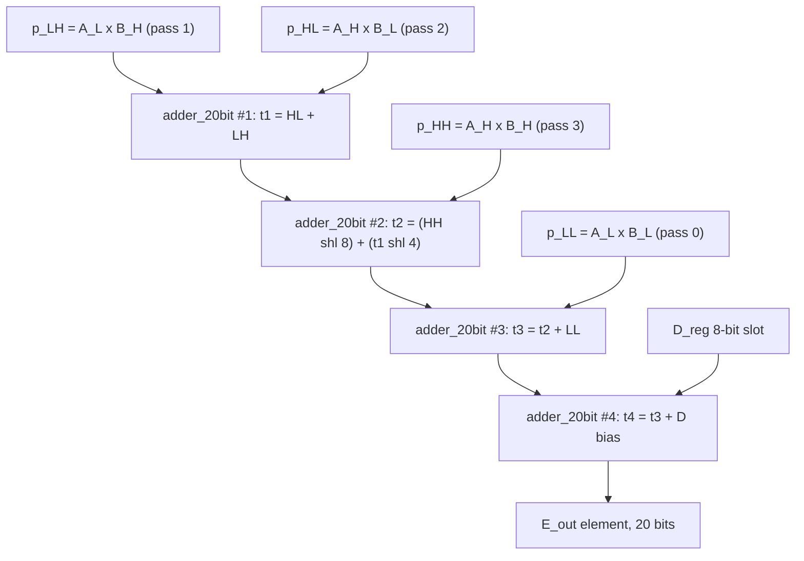

> **Note:** during 8-bit passes, `core_D_flat` is forced to **zero** by the bias mux, otherwise `D` would be added four times instead of once. The bias is instead injected exactly once, after recombination, in `add4` above. For 2-bit/4-bit modes, `D` _is_ added inside the core every pass, since there is no recombination.

**Bus width (why 320 bits?):** `E_out` is 16 elements × **20 bits** each. 20 bits comfortably covers the worst case: an 8-bit × 8-bit product is 16 bits, a 4-term dot product of such products needs 2 more guard bits (18), and adding an 8-bit bias needs at most 1 more (19–20). The internal `core_E_flat` (12-bit elements) is sized the same way for the 4-bit-native worst case: $4\times4$ product = 8 bits, ×4 terms ≈ 10 bits, +4-bit bias fits inside 12.

**`simple_tensor_core`:**

```verilog
module simple_tensor_core(
    input          clk, reset, start,
    input  [1:0]   mode,
    input  [127:0] A_in, B_in, D_in,
    output [319:0] E_out,
    output         valid,
    output         busy
);
    wire        core_reset, core_start;
    wire [1:0]  pass_idx;
    wire        capture_en, combine_en;
    wire [63:0] core_A_flat, core_B_flat, core_D_flat;
    wire [191:0] core_E_flat;
    wire        idle;

    data_ctrl_unit ctrl (
        .clk(clk), .reset(reset), .start(start), .mode(mode),
        .core_reset(core_reset), .core_start(core_start),
        .pass_idx(pass_idx),
        .capture_en(capture_en), .combine_en(combine_en),
        .valid(valid), .busy(busy), .idle(idle)
    );

    wire io_latch_en = start & idle;

    io_manager io (
        .clk(clk), .reset(reset), .latch_en(io_latch_en), .mode(mode),
        .A_in(A_in), .B_in(B_in), .D_in(D_in),
        .pass_idx(pass_idx),
        .capture_en(capture_en), .combine_en(combine_en),
        .core_E_flat(core_E_flat),
        .core_A_flat(core_A_flat), .core_B_flat(core_B_flat), .core_D_flat(core_D_flat),
        .E_out(E_out)
    );

    tensor_module core (
        .clk(clk),
        .reset(reset | core_reset),
        .start(core_start),
        .A_flat(core_A_flat), .B_flat(core_B_flat), .D_flat(core_D_flat),
        .E_flat(core_E_flat)
    );
endmodule
```

> **Note:** `wire io_latch_en = start & idle;` operands are only latched into `A_reg`/`B_reg`/`D_reg`/`mode_reg` on the _same_ cycle `start` is asserted while the FSM is genuinely idle, so a `start` pulse that arrives while `busy` is high is safely ignored rather than corrupting an in-flight operation. Also note `reset | core_reset` feeding `tensor_module`: the core resets both on a full system reset _and_ on every `S_CORE_RESET` pulse between 8-bit passes, clearing every `pe`'s accumulator before the next partial product begins.

### 2.6 Top-Level Signal Flow

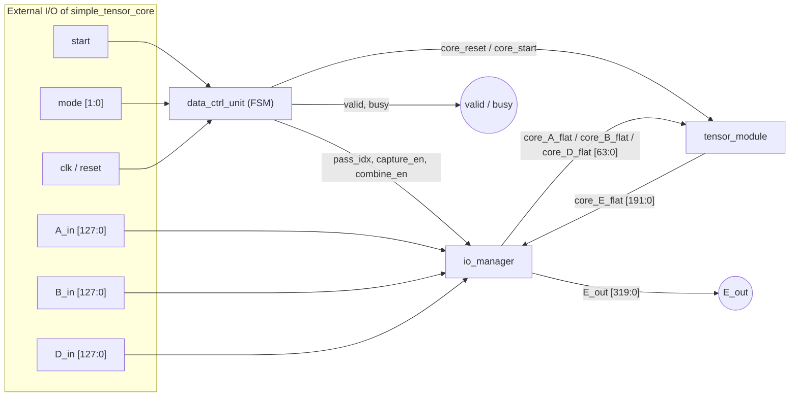

---

## 3. Testing & Verification

### 3.1 Simulation Toolchain

- **Compiler / simulator:** Icarus Verilog.
- **Waveform viewer:** Surfer.

### 3.2 Bottom-Up Test Strategy

1. **`full_adder` / `adder_4bit` / `carry_adder_4bit`** truth-table sweep to verify `Sum`/`Cout` against a Verilog-model reference. See **Figures 1–2**.
2. **`multiplier_4bit`** swept representative operand pairs and compared `Product` against `A*B` computed by the testbench's own reference model. See **Figure 3**.
3. **`pe`** verified that `sum_out` accumulates correctly across multiple clock cycles for a fixed `(a_in, b_in)` stream, and clears to `0` on `reset`. See **Figure 4**.
4. **`row_stagger` / `mem_reuse_pipe`** verified the stagger delays (Row 0 appears at cycle 0, Row 1 at cycle 1, etc.) _and_ verified the transpose: fed a known asymmetric matrix for `B` and confirmed `b_col0..3` present the correct column. See **Figures 5–6**.
5. **`matrix_mult_4x4` / `systolic_4x4`** full 4×4 × 4×4 multiplications against a golden software model, including identity and zero matrices. See **Figure 7**.
6. **`matrix_add_4x4` / `tensor_module`** verified `E = A×B + D` end-to-end against the same golden model. See **Figures 8–9**.
7. **`data_ctrl_unit`** verified state transitions and the exact cycle count of `busy`/`valid` pulses, in isolation, by driving `start`/`mode` and forcing `capture_en`/`combine_en` responses. See **Figure 10**.
8. **`io_manager` / `simple_tensor_core`** full-precision sweep at all three modes end-to-end. See **Figure 11**.

### 3.3 Test Case Matrix

| Category            | Module(s) Under Test               | Test Vectors                                                                                                                                                          |
| ------------------- | ---------------------------------- | --------------------------------------------------------------------------------------------------------------------------------------------------------------------- |
| Basic Math          | `matrix_mult_4x4`, `tensor_module` | Identity × Identity; Zero matrix; `A × I + 0 = A`                                                                                                                     |
| Boundary 4-bit path | `multiplier_4bit`, `pe`            | `15 × 15 = 225`; `0 × 15 = 0`; accumulate 4× `15×15` without saturation                                                                                               |
| Boundary 8-bit path | `io_manager`, `simple_tensor_core` | `255 × 255`; dot-product of four `255×255` terms + `255` bias, checking the 20-bit `adder_20bit` chain does not overflow (max ≈ 260,865, fits in 20 bits = 1,048,575) |
| Precision 2-bit     | `io_manager`                       | Elements 0–3 packed 4-per-byte, verify `operand_nibble` extracts `{2'b00, slot[1:0]}` correctly                                                                       |
| Precision 4-bit     | `io_manager`                       | Elements 0–15 packed 2-per-byte, verify low-nibble extraction                                                                                                         |
| Precision 8-bit     | `io_manager`                       | Elements 0–255, verify 4-pass `LL/LH/HL/HH` capture and shift-add recombination against a golden 8-bit reference multiply, visible in Figure 11                       |
| FSM / Handshake     | `data_ctrl_unit`                   | `busy` asserts exactly on the cycle after `start`; `valid` pulses for exactly one cycle in `S_DONE`; back-to-back `start` pulses are correctly rejected while `busy`  |
| Reset               | All sequential modules             | Assert `reset` mid-operation; confirm all registers (`pe.sum_out`, FSM `state`, `io_manager` partial-product regs) return to `0`                                      |

### 3.4 Waveform Evidence

All screenshots below are taken directly from Surfer while replaying the `.vcd` traces produced by the Icarus Verilog testbenches.

**Figure 1 `adder_4bit`**


`tb_adder_4bit` drives `A`, `B` and an alternating `Cin` through the full input space while the DUT scope tree shows the four instantiated `full_adder` cells (`fa0`…`fa3`) that make up the ripple chain. `Sum` tracks `B` and wraps correctly from 15 back to 0, and `Cout` only rises for the specific `A+B+Cin` combinations that overflow 4 bits, confirming the ripple-carry adder's `Sum`/`Cout` against the reference model bit-for-bit.

**Figure 2 `carry_adder_4bit`**


The same test bench and stimulus pattern applied to `carry_adder_4bit` instead. `Sum` and `Cout` line up cycle-for-cycle with Figure 1, confirming the two adder implementations are functionally identical even though their internal structure is completely different.

**Figure 3 `multiplier_4bit`**

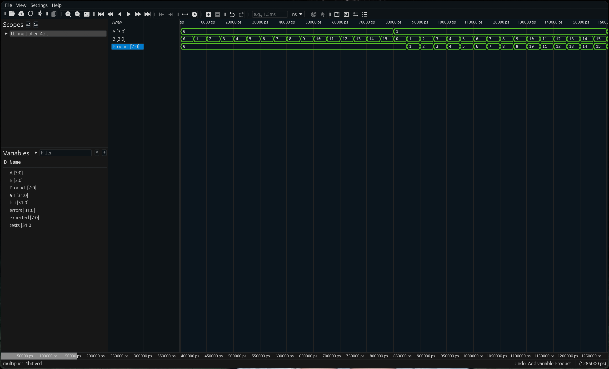

With `A` held at `0`, `Product` stays `0` regardless of `B` (covering the `0×N` boundary case). Once `A` becomes `1`, `Product` tracks `B` directly (`1×N = N`) as `B` sweeps `0`→`15`, a clean spot-check of the partial-product-and-add tree before it gets buried inside the `pe`.

**Figure 4 `pe`**

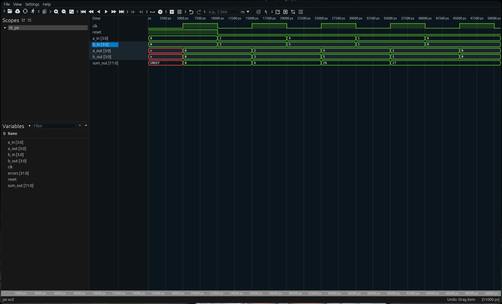

A short stream of `(a_in, b_in)` pairs (`(0,0)`, `(2,3)`, `(4,5)`, `(1,1)`, `(0,0)`) is fed into the processing element. `sum_out` accumulates the running dot product each clock (`0 → 6 → 26 → 27 → 27`), matching `0·0 + 2·3 + 4·5 + 1·1 = 27`, while `a_out`/`b_out` show the one-cycle registered pass-through to the next cell in the grid.

**Figure 5 `row_stagger`**

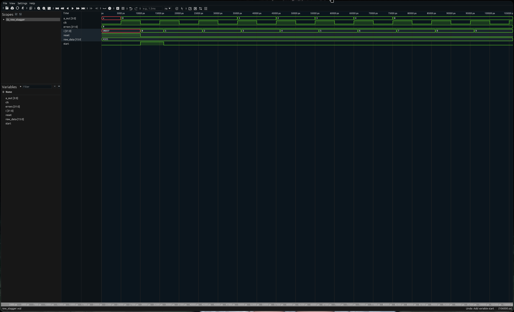

`row_data = 16'h4321` is parallel-loaded on the `start` pulse and then shifted out one nibble per clock: `a_out` sequences `1 → 2 → 3 → 4` before returning to `0`, confirming the shift register empties least-significant-nibble-first exactly as `mem_reuse_pipe` expects.

**Figure 6 `mem_reuse_pipe`**

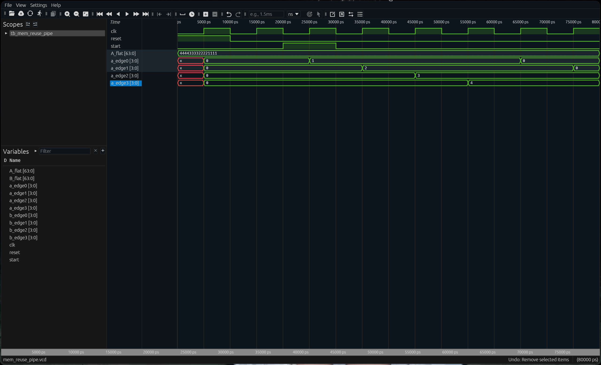

`A_flat = 64'h4444_3333_2222_1111` (row0 = `0x1111`, row1 = `0x2222`, row2 = `0x3333`, row3 = `0x4444`). After `start`, `a_edge0` (`DELAY = 0`) is the first to present its row's value, `a_edge1` (`DELAY = 1`) follows one clock later, then `a_edge2`, then `a_edge3`, confirming the `row_stagger #(.DELAY(n))` chain staggers row 0 → row 3 by exactly one cycle each, as required for the systolic timing in 2.3.

**Figure 7 `systolic_4x4`**

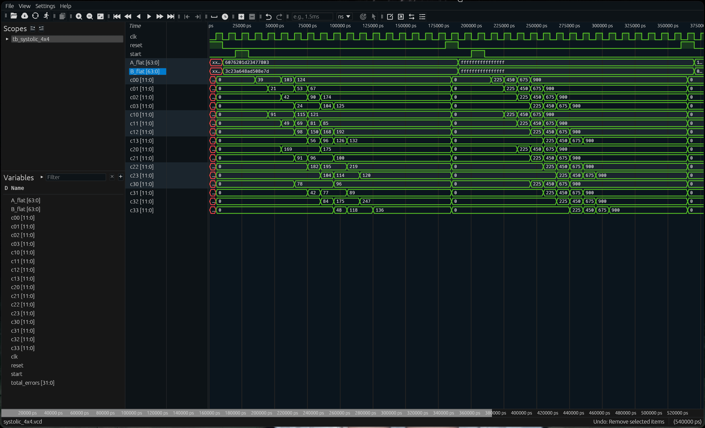

Two back-to-back `start` pulses drive two independent test cases. The first uses distinct, "random-looking" `A_flat`/`B_flat` operands and every `c_ij` settles at a distinct value, confirming the systolic array against the golden software model element-by-element. The second test drives every nibble of `A_flat` and `B_flat` to `0xF` (`15`) and every `c_ij` settles to the identical sequence `0 → 225 → 450 → 675 → 900` — this is the "accumulate four `15×15` terms without saturation" boundary case from 3.3, and `900` sits comfortably under the `pe` accumulator's `4095` ceiling.

**Figure 8  `matrix_add_4x4`**

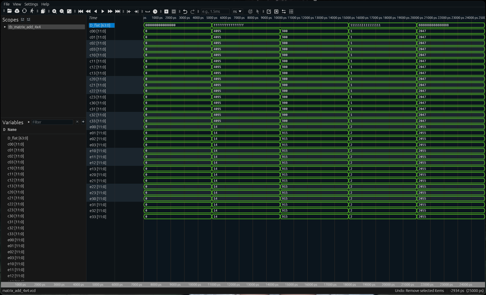

`D_flat` is swept through boundary hex patterns (all-zero, all-`F`, an alternating `0x1` pattern, and `0x8` (mid-range)) while `C` is held at a fixed 12-bit value for each case. Every one of the 16 `e_ij` outputs tracks `c_ij + d_ij` in lock-step across all four cases, confirming `matrix_add_4x4`'s 16 parallel `adder_12bit` instances are wired correctly.

**Figure 9 `tensor_module`**

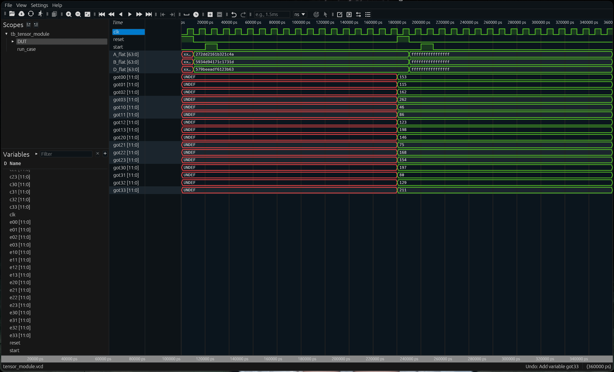

Two `start` pulses again drive two test cases; the scope tree shows the `run_case` testbench task and the instantiated `DUT`. For the second test case, all 16 `got_ij` outputs settle to their golden-model expected values (`153, 115, 162, 262, 46, 86, 123, 198, 146, 75, 168, 154, 197, 80, 129, 211`), confirming the full `systolic_4x4 → matrix_add_4x4` pipeline computes `E = A×B + D` correctly.

**Figure 10 `data_ctrl_unit`**

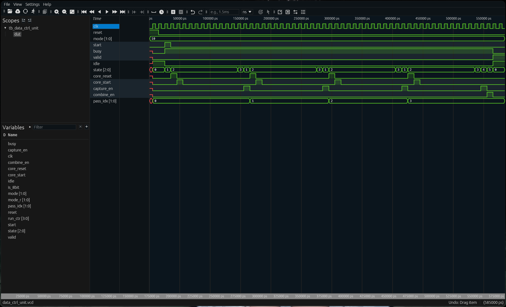

With `mode = 2'b10` (8-bit) and a single `start` pulse, `state` visibly loops `S_CORE_RESET(1) → S_RUN(2) → S_CAPTURE(3)` **four times** (once per `pass_idx` value `0, 1, 2, 3`) before finally advancing to `S_COMBINE(4)` and `S_DONE(5)` and returning to `S_IDLE(0)`. `core_reset` and `core_start` each pulse once per loop, `capture_en` pulses once per loop, and `combine_en` pulses exactly once, right before the single `valid` pulse.

**Figure 11 `simple_tensor_core`**

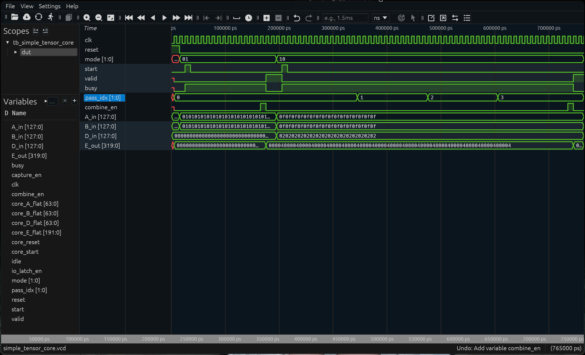

Two back-to-back operations on the full top-level design: the first with `mode = 2'b01` (4-bit, single pass) completes with one `valid` pulse and a short `busy` window; the second with `mode = 2'b10` (8-bit) shows `pass_idx` counting `0 → 1 → 2 → 3` and `combine_en` pulsing once at the end of the fourth pass, with `E_out` only updating after that final `combine_en`.

### 3.5 Latency & Timing Analysis

**Clock-cycle latency, derived from the FSM (`run_ctr` counts 0→10, i.e. 11 cycles in `S_RUN`):**

| Precision Mode          | State sequence                                                              | Cycle cost              | Total (`start`→`valid`) |
| ------------------------ | ----------------------------------------------------------------------------- | ------------------------- | -------------------------- |
| 2-bit / 4-bit (1 pass)   | `S_CORE_RESET`(1) + `S_RUN`(11) + `S_CAPTURE`(1) + `S_COMBINE`(1) + `S_DONE`(1) | 15 + 1 (IDLE→RESET transition) | **≈ 16 clock cycles**       |
| 8-bit (4 passes)         | 4 × [`S_CORE_RESET`(1) + `S_RUN`(11) + `S_CAPTURE`(1)] + `S_COMBINE`(1) + `S_DONE`(1) | 4×13 + 2                | **≈ 54 clock cycles**       |

These counts match the number of `state` transitions actually observed in **Figure 10** (four full `S_CORE_RESET → S_RUN → S_CAPTURE` loops for 8-bit mode) and **Figure 11** (a visibly longer `busy` window for the 8-bit operation than the 4-bit one), which is the cycle-accurate ground truth these hand-derived numbers are meant to approximate.

**Maximum theoretical clock frequency, where's the critical path?**

It's tempting to assume the systolic grid (`pe`) is the bottleneck, since it's the module doing the "real work" every cycle. But tracing actual combinational depth:

- **Per-cycle path through `pe`:** `multiplier_4bit` (AND + 3 chained `adder_8bit`, each = 2 ripple-linked `carry_adder_4bit` blocks ≈ 6 lookahead-stage delays) → `adder_12bit` accumulate (3 more lookahead-stage delays) ≈ **~9 lookahead-block delays**, and this _is_ registered every clock (it's what `run_ctr` is timing).
- **Per-operation path through `io_manager`'s `S_COMBINE` logic:** four **chained** `adder_20bit` instances (`add1→add2→add3→add4`), each itself 5 ripple-linked `carry_adder_4bit` blocks, a **fully combinational chain of ≈ 20 lookahead-block delays**, that must settle within a _single_ clock period (the `S_COMBINE` state is exactly one cycle) before being captured into `E_reg`.

**Conclusion:** the true critical path, and therefore the true limit on $f_{max}$, is not the systolic grid's per-cycle MAC path, but the **8-bit recombination chain inside `io_manager`**, since it is more than twice as deep and still only gets one clock period to resolve. The next step would be running static timing analysis on this specific path to get an actual $t_{pd}$ number in nanoseconds; conceptually: 

$T_{clk,min} \gtrsim 20 \times t_{pd}(\text{carry\_adder\_4bit}) + t_{setup}(\text{E\_reg})$.

---

## 4. Conclusion & Future Scope

### 4.1 Summary of Achievements

This project successfully bridged low-level gate logic (`full_adder`, AND-gate partial products) with high-level neural-network mathematics (`E = A×B + D`), through hierarchical, bottom-up design:

- Built and independently verified every combinational primitive before composing them.
- Implemented **pipelining with per-stage registers** inside `pe`, breaking a long combinational multiply-accumulate path into single-cycle stages.
- Implemented a **systolic array** with data reuse: every element of `A` and `B` is fetched from the input bus exactly once and then reused by up to four MAC operations as it physically streams through the grid.
- Solved matrix orientation with a **hardware transpose** instead of spending clock cycles.
- Designed a **Finite State Machine** (`data_ctrl_unit`) that correctly sequences a single physical 4-bit-wide datapath through 1 or 4 passes depending on requested precision, and correctly defers the `D` bias addition to avoid quadruple-counting it in 8-bit mode.
- Wrote self-checking, testbenches for every module, using Icarus Verilog + Surfer as the verification toolchain, and captured real waveform evidence for all 11 levels of the hierarchy (3.4).

### 4.2 Core Takeaway

Real AI accelerators are not magic, they are exactly this, scaled up: adders, multipliers, registers, multiplexers, and FSMs, arranged spatially so that data reuse (not raw clock speed) is what delivers throughput. This project proves that a scaled-down, 4×4, 4-bit-native tensor core can be built entirely from the primitive LC concepts, and that the same physical grid can be time-multiplexed to support higher precisions without duplicating hardware.

### 4.3 Limitations & Future Expansion

Hardware is never "finished." To turn this execution unit into part of a real System-on-Chip, the following would be needed next:

- **Activation function support:** add a hardware ReLU module downstream of `E_out`, since real neural-network layers apply an activation immediately after the matrix-multiply-add.
- **Bus protocol wrapping:** wrap `simple_tensor_core`'s custom `start`/`busy`/`valid` handshake in a standard interconnect protocol so a real CPU or DMA engine could drive it without a custom driver.
- **Memory hierarchy:** add an SRAM-backed global buffer in front of `A_in`/`B_in`/`D_in` so that larger-than-4×4 matrices could be tiled and streamed in, rather than requiring the entire operand set to be presented on the input bus at once, this would remove the current design's implicit assumption that all 128 bits of each operand are available simultaneously, and would prevent memory-bandwidth bottlenecks as matrix sizes grow.
- **Deeper pipelining of the 8-bit recombination path:** per the timing analysis in 3.5, the `io_manager` combine chain is the actual critical path; splitting `add1→add2→add3→add4` across two pipeline stages would very likely raise $f_{max}$ without touching the systolic grid at all.
- **Parametrization:** generalize the 4×4, 4-bit-native grid size and native width to Verilog parameters, so the same RTL could scale to 8×8 or 16-bit-native without hand-editing every module.

---

## Appendix A — Full Module Reference

| #   | Module               | Phase           | Type       | Key Ports                                                                                                                               | One-line Description                                                                        |
| --- | -------------------- | --------------- | ---------- | --------------------------------------------------------------------------------------------------------------------------------------- | ------------------------------------------------------------------------------------------- |
| 1   | `full_adder`         | 1               | Comb.      | `A,B,Cin → S,Cout`                                                                                                                      | 1-bit full adder primitive                                                                  |
| 2   | `adder_4bit`         | 1               | Comb.      | `A[3:0],B[3:0],Cin → Sum[3:0],Cout`                                                                                                     | Ripple-carry 4-bit adder                                                                    |
| 3   | `carry_adder_4bit`   | 1               | Comb.      | `A[3:0],B[3:0],Cin → Sum[3:0],Cout`                                                                                                     | Carry-lookahead 4-bit adder                                                                 |
| 4   | `adder_8bit`         | 1 (support)     | Comb.      | `A[7:0],B[7:0],Cin → Sum[7:0],Cout`                                                                                                     | 2× `carry_adder_4bit`                                                                       |
| 5   | `adder_12bit`        | 1 (support)     | Comb.      | `A[11:0],B[11:0],Cin → Sum[11:0],Cout`                                                                                                  | 3× `carry_adder_4bit`                                                                       |
| 6   | `multiplier_4bit`    | 1               | Comb.      | `A[3:0],B[3:0] → Product[7:0]`                                                                                                          | 4×4→8-bit multiplier via AND partial products + `adder_8bit` chain                          |
| 7   | `matrix_add_4x4`     | 3               | Comb.      | 16× `[11:0]` C inputs, `D_flat[63:0] →` 16× `[11:0]` E outputs                                                                          | 16 parallel `adder_12bit`                                                                   |
| 8   | `pe`                 | 2               | Seq.       | `clk,reset,a_in,b_in[3:0],sum_in[11:0] → a_out,b_out[3:0],sum_out[11:0]`                                                                | `sum_out=sum_in+a_in×b_in`, registers `a`/`b` pass-through                                  |
| 9   | `matrix_mult_4x4`    | 2               | Seq.       | `clk,reset`, 4× `a_edge[3:0]`, 4× `b_edge[3:0] →` 16× `c[11:0]`                                                                         | 4×4 grid of `pe`, wired for output-stationary systolic multiply                             |
| 10  | `row_stagger`        | 2               | Seq.       | `#(DELAY)`, `clk,reset,start,row_data[15:0] → a_out[3:0]`                                                                               | Parameterized delay-chain + shift-register: staggers row/column entry                       |
| 11  | `mem_reuse_pipe`     | 2               | Seq.       | `clk,reset,start,A_flat[63:0],B_flat[63:0] →` 4× `a_edge`, 4× `b_edge`                                                                  | 8× `row_stagger`; also performs transpose of B                                              |
| 12  | `systolic_4x4`       | 2               | Seq.       | `clk,reset,start,A_flat,B_flat[63:0] →` 16× `c[11:0]`                                                                                   | `mem_reuse_pipe` + `matrix_mult_4x4` combined                                               |
| 13  | `tensor_module`      | 3               | Seq.+Comb. | `clk,reset,start,A_flat,B_flat,D_flat[63:0] → E_flat[191:0]`                                                                            | `systolic_4x4` output routed into `matrix_add_4x4`: computes `E=A×B+D`                      |
| 14  | `adder_20bit`        | Final (support) | Comb.      | `A[19:0],B[19:0],Cin → Sum[19:0],Cout`                                                                                                  | 5× `carry_adder_4bit`; used for 8-bit partial-product recombination                         |
| 15  | `data_ctrl_unit`     | Final           | Seq. (FSM) | `clk,reset,start,mode[1:0] → core_reset,core_start,pass_idx[1:0],capture_en,combine_en,valid,busy,idle`                                 | 6-state FSM controlling single-pass vs. 4-pass (8-bit) operation                            |
| 16  | `io_manager`         | Final           | Seq.+Comb. | `clk,reset,latch_en,mode,A_in/B_in/D_in[127:0],pass_idx,capture_en,combine_en,core_E_flat[191:0] → core_A/B/D_flat[63:0], E_out[319:0]` | Precision muxing (`operand_nibble`), partial-product capture, 8-bit shift-add recombination |
| 17  | `simple_tensor_core` | Final           | Top-level  | `clk,reset,start,mode[1:0],A_in,B_in,D_in[127:0] → E_out[319:0],valid,busy`                                                             | Wires `data_ctrl_unit` + `io_manager` + `tensor_module` together                            |

---
